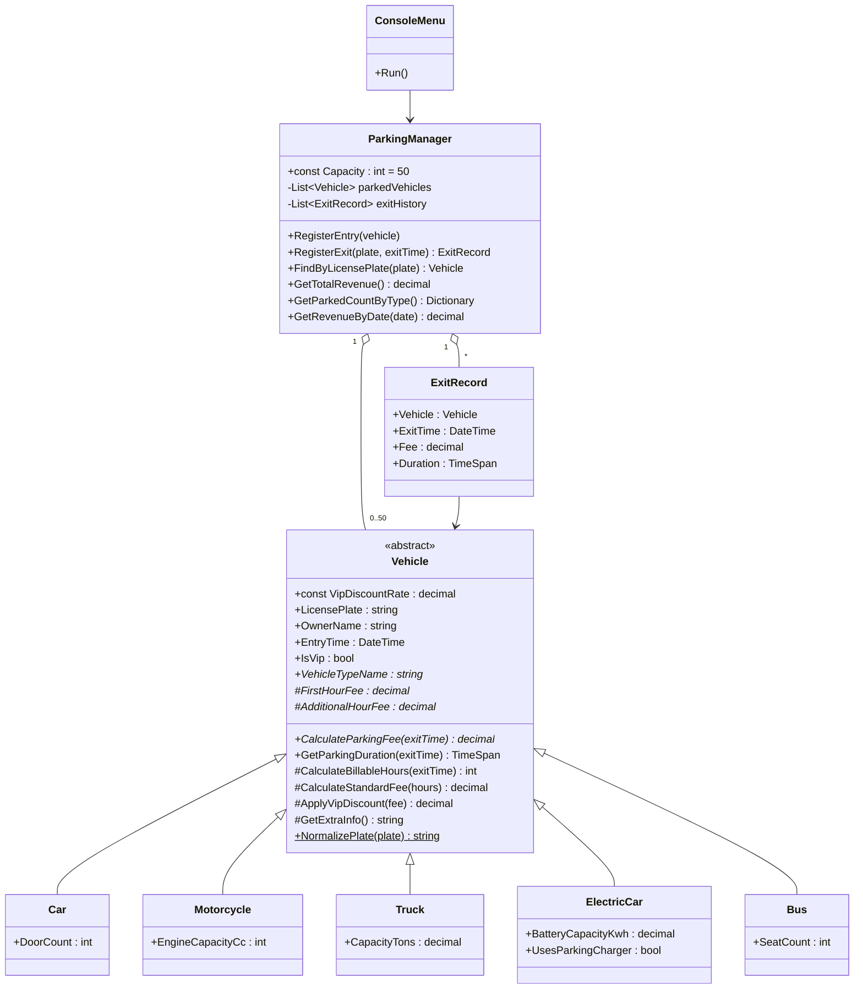

# نمودار کلاس‌ها (UML)

این نمودار با Mermaid نوشته شده است. می‌توانید آن را در https://mermaid.live یا در VS Code (افزونه Markdown Preview Mermaid) باز کنید، تصویرش را بگیرید و در PDF تحویلی قرار دهید.

## تصمیم طراحی درباره ElectricCar

ElectricCar مستقیماً از Vehicle ارث می‌برد، نه از Car. دلایل:

1. تعرفه‌ی آن متفاوت است (۲۰٬۰۰۰ / ۱۵٬۰۰۰) و اگر از Car ارث می‌برد باید همه‌ی خصوصیات تعرفه‌ای Car را بازنویسی می‌کرد.
2. ویژگی‌های Car (مثل تعداد درب) برای خودرو برقی در این مسئله معنایی ندارد.
3. رابطه‌ی ارث‌بری باید «is-a» واقعی و بدون تحمیل رفتار اضافی باشد (اصل جایگزینی لیسکوف).
